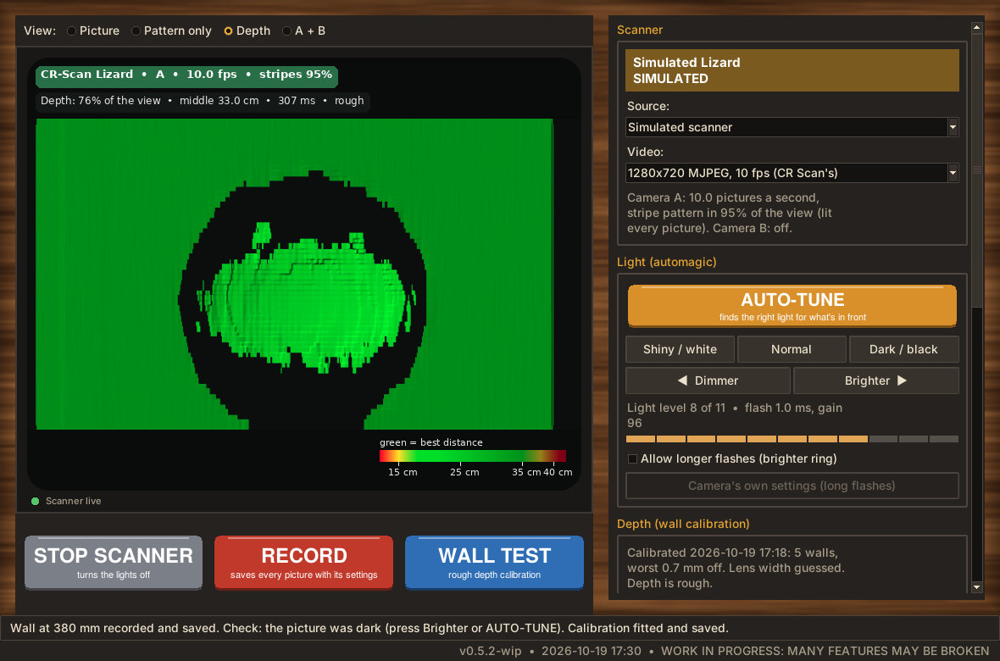
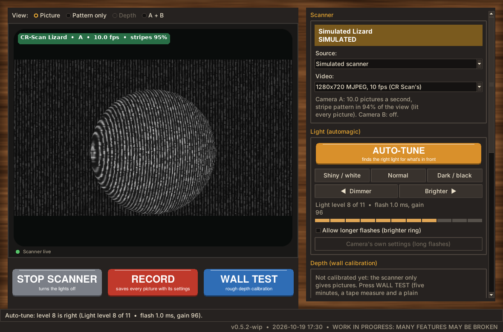
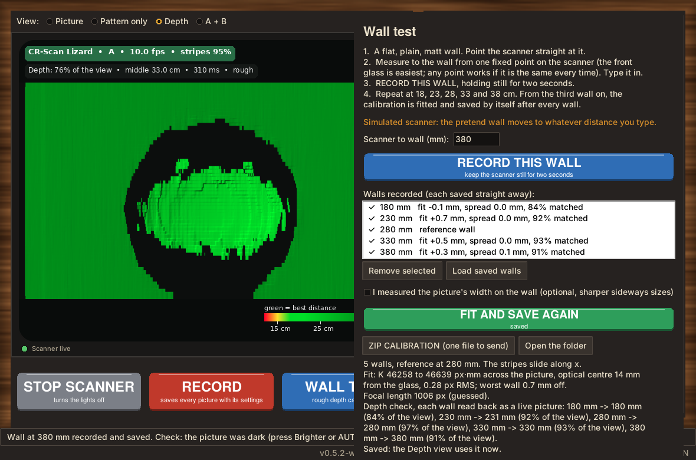
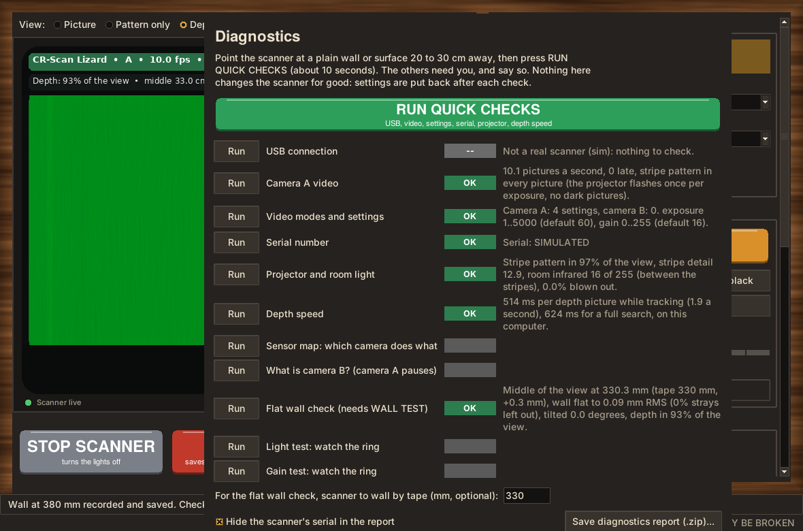
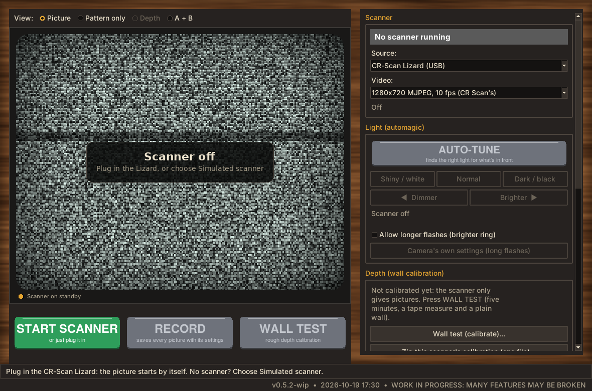
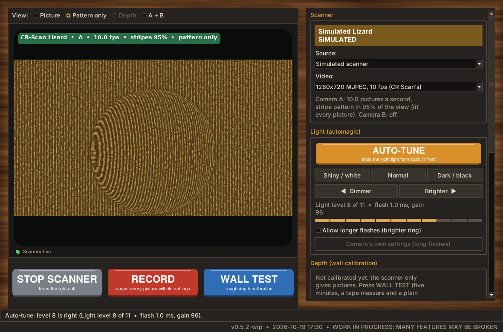
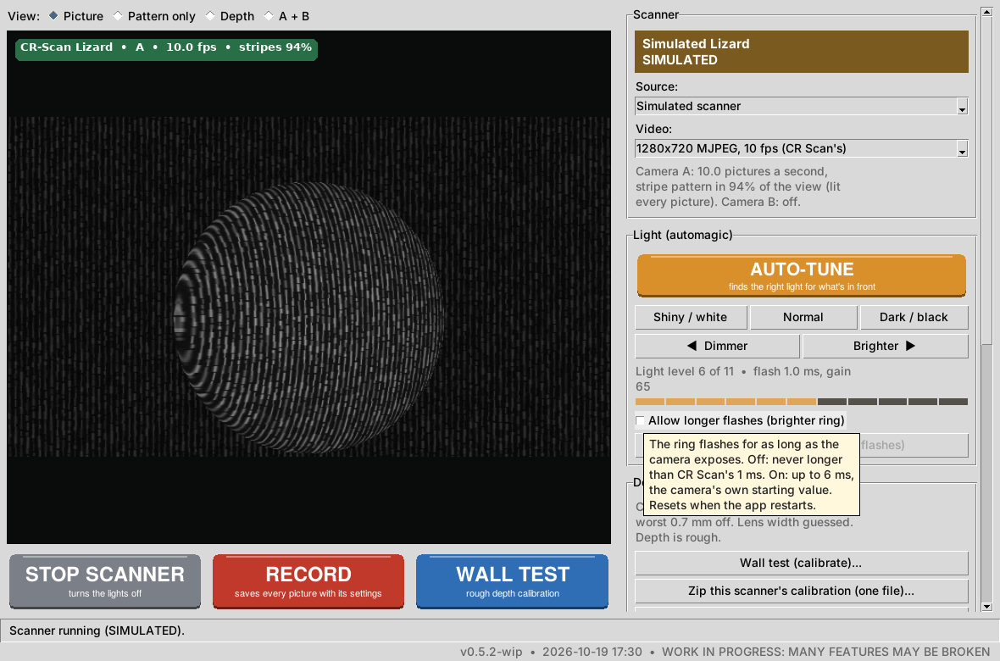

# FREE (open) Lizard Scanner

> **Paused for a month or two.** Calibration turned out to be more boring than cleaning, and after weeks of
> mad science projects the cleaning has been neglected for long enough. The app works as far as described
> below; the notes say exactly where it stopped. Issues and ideas are still welcome.

> **The paper:** [Down the Lizard Hole](docs/paper/down-the-lizard-hole.pdf), the whole reverse-engineering
> story in plain English (also in its own repository,
> [down-the-lizard-hole](https://github.com/The-Dorkknight/down-the-lizard-hole)).

> **WORK IN PROGRESS: MANY FEATURES MAY BE BROKEN.** Version 0.5.2-wip. Proof of concept.
> The camera control, the light buttons and the diagnostics have run on the owner's real CR-Scan
> Lizard. The first real wall test (0.4) failed because the projector throws **stripes, not dots**;
> 0.5 rebuilds depth for the stripes and was checked on that wall test's saved data and one saved
> picture (walls back within 2 mm). The first live test (19 October) gave a flat wall where the
> calibration was good, with wrong-stripe streaks that 0.5.1 removes; a second calibration did worse for
> reasons not yet known. See [the findings](docs/research/real-scanner/2026-10-18-stripes.md).

**Licence:** [PolyForm Noncommercial 1.0.0](LICENSE.md). Source-available, non-commercial.
Free for personal and other non-commercial use; commercial use needs permission. No warranty
and no liability: it is provided as is. Not made by, or affiliated with, Creality.

A standalone app for the **Creality CR-Scan Lizard** 3D scanner that does not need Creality's
software: a live infrared picture, **automagic buttons instead of sliders** for the light, a
**wall test** that gives the scanner a rough depth calibration, a live depth view, point-cloud
export and recordings. It is built on the bones of
[Scantastic](https://github.com/The-Dorkknight/scantastic) and the Lizard engine from
[Who are yoUSB?](https://github.com/The-Dorkknight/who-are-yousb), and is laid out so the Lizard
can move into Scantastic later ([INTEGRATION.md](INTEGRATION.md)).

*Screenshots are of the built-in simulated scanner, not a real Lizard.*

## What exists, and what does not

| Works (on the simulated scanner) | Not yet |
|---|---|
| Finding the Lizard's two cameras (USB bcdc:000a / 000b) and starting them (Linux) | Tried on a real Lizard with this app |
| Live picture, "pattern only" view, camera A + B side by side | Full 3D scans (many views joined into a mesh): that is Scantastic's job, see [INTEGRATION.md](INTEGRATION.md) |
| AUTO-TUNE, three presets, Brighter / Dimmer, flash capped at 1 ms | Lens distortion correction |
| Diagnostics: 10 checks and a report zip | |
| Wall test: rough depth calibration from 3 to 5 walls, saved as you go, all in one folder, one-click zip | Creality's own factory calibration (not found) |
| Live depth view, save points as .ply | Windows and macOS camera paths (written, never run) |
| Recording sessions and playing them back | Colour (the Lizard's pictures are infrared) |
| Light test, "What is camera B?" test | |

## Install and start

**Double-click the launcher for your computer** in this folder:

| System | Launcher | First time |
|---|---|---|
| Linux (Mint, Ubuntu, Debian) | `Lizard-Scanner-Linux.sh` | Choose "Run". If asked, install: `sudo apt install python3-tk python3-venv v4l-utils` |
| Windows | `Lizard-Scanner-Windows.bat` | Needs Python 3 from python.org. **Experimental, untested** |
| macOS | `Lizard-Scanner-Mac.command` | Right-click, Open, Open (it is unsigned). **Experimental, untested** |

The first start installs numpy and Pillow (plus OpenCV on Windows and macOS) into `lz_env/`
in this folder, then opens the window. Nothing is installed anywhere else. Only the Linux
launcher has been run so far.

**No scanner?** Choose *Simulated scanner* in the Source box, or start with
`python3 lizard_scanner.py --simulate`. Everything works against a pretend Lizard looking at
a ball in front of a wall.

Other options: `--plain` (no wood-panelled TV look), `--version`.

## Using it

### 1. The picture

Plug the Lizard in. On Linux the picture starts by itself within a few seconds (the app
looks for it every 2.5 s). The green tag on the picture says how many pictures a second
arrive and how much of the view shows the projector's stripes. The projector (camera A's light)
flashes once per picture, so every picture carries its pattern; the red glow looks like flicker.

The **View** row switches between:

- **Picture**: the infrared picture with the projector's stripes.
- **Pattern only**: the stripes with the background light taken away. What the depth is made from.
- **Depth**: needs a wall test first.
- **A + B**: both cameras side by side.

### 2. The light: automagic buttons

Creality's own app only ever changes two settings, exposure and gain. Here they are a
ladder of 11 light levels instead of two sliders:

- **AUTO-TUNE** walks the ladder until the stripes are bright but not blown out, from whatever
  is in front of the scanner. Press it again to stop.
- **Shiny / white**, **Normal**, **Dark / black**: presets. Normal is what Creality's app
  uses (1 ms, gain 65); Shiny / white is its dimmest setting.
- **Dimmer / Brighter**: one step of the ladder.

**The ring's brightness is the flash length.** The white ring is camera B's light, the infrared
projector camera A's. Both cameras start at Creality's 1 ms, never on their own automatic exposure,
and camera B follows these buttons whenever it runs. The ring and the projector flash for as
long as the camera exposes, and at Creality's 1 ms the ring is already very bright. So the
ladder never flashes longer than 1 ms; above that it adds gain (picture amplification), which
brightens the picture without touching the lights. The bar under the buttons shows the rungs.

- **Allow longer flashes**: an advanced switch, with a warning, for dark objects. Brighter then
  goes up to 6 ms (the camera's own starting value, never more); those rungs show red. It
  switches itself off when the app closes.
- **Camera's own settings (long flashes)**: back to the camera's own automatic exposure. Only
  with longer flashes allowed, because the camera then picks its own (often long) flash.

Every raw setting is still there under *Every camera setting (advanced)*; setting a flash longer
than 1 ms there asks first.

### 3. The wall test: rough depth calibration

The Lizard's camera A sees a fixed pattern from its projector: dense vertical stripes, each a string
of beads whose width wobbles. When the scanner moves closer to a wall, the stripes slide sideways in
the picture, by an amount that depends on the distance (and, on the real scanner, a little on where
in the picture). The beads' wobble tells one stripe from the next. Measure that slide at a few known
distances and every picture afterwards can be turned into depth. The original Kinect worked the same
way with dots.

You need a flat, plain, matt wall and a tape measure. About five minutes.

1. Press **WALL TEST**.
2. Point the scanner straight at the wall. Measure to the wall from one fixed point on the scanner
   (the front glass is easiest; any point works if you use the same one every time; depth is then
   counted from that point) and type the distance in millimetres.
3. Press **RECORD THIS WALL** and hold still for two seconds. (Before the first wall the app
   runs AUTO-TUNE by itself.)
4. Repeat at five distances: 18, 23, 28, 33 and 38 cm are suggested (Creality gives the
   Lizard's working range as 15 to 40 cm). Three is the least; spreading the walls over the
   whole range matters, because depth gets less certain beyond the nearest and farthest wall.
5. **Nothing to press to save.** Every wall is saved the moment it is recorded, and from the third
   wall on the calibration is fitted and saved by itself; the Depth view turns on. The list shows
   how well each wall fits, and the window warns about a wall at an angle (one that disagrees with
   the others is left out) or a scanner turned to the wall. *FIT AND SAVE AGAIN* is only needed after
   typing a picture width.

**Everything for one scanner's calibration is in one folder**, `calibration/<serial>/`: the fit
(`calibration.json`), the wall patterns and K map (`reference.npz`), the measured shift maps, the report,
and `walls/` with three of the camera's own full-size pictures of each wall. **ZIP CALIBRATION** (in the
wall test, or *Zip this scanner's calibration* under Depth) packs it into one file next to it, with the
serial hidden when the Capture box says so. *Load saved walls* brings the walls back to fit again, also
from an older version of the app: a 0.4 calibration is refitted for the stripes without new walls.

Optional: tick *I measured the picture's width* and type how wide the picture is on the wall
at a known distance. Without it, the lens is guessed from Creality's spec (200 mm across),
which only affects sideways sizes in exported points, not depth.

### 4. Depth and points

The Depth view colours the scene green in the sweet spot (18 to 35 cm), through yellow to red
outside it, with shading so shapes show. **Save this view as points (.ply)** writes the current
depth as a point cloud in millimetres, which MeshLab, CloudCompare or Blender can open.

### 5. Capturing frames, recording and playing back

Every saved picture is stamped with **when it arrived, which camera, the exposure, the gain, the
auto-exposure mode and every other camera setting in force**, plus its brightness, fine detail, how much
of it shows the projector's pattern, its sharpness, the light-ladder rung and the stream's own picture
number. Every setting change (light buttons, AUTO-TUNE, tests) is logged as it happens, so pictures from
before and after a change never get mixed up.

- **Save frame now** (Capture panel): one picture from each running camera.
- **RECORD**: every picture from every running camera (camera B joins when the A + B view starts it).
  *every* saves only every Nth picture for long recordings.
- **Notes**: type e.g. "covered camera A" and press Add note; it is stamped on the next picture and kept in
  the timeline. With nothing recording, it goes on the next capture.
- **Hide the scanner's serial** (on by default) masks it in captures and in test reports.

Each capture is a folder `captures/capture_<date>_<time>_<name>/`: the camera's own JPEGs (no quality lost)
in `frames/`, `frames.csv` (one row per picture with all the stamps), `events.jsonl` (settings snapshots,
every change, notes) and `session.json`. *Source > Play back a recording...* plays one back as if it were
the scanner. The capture code is shared with Who are yoUSB? (`lizard_framecap.py`); see
[docs/framecap-in-lizard-scanner.md](docs/framecap-in-lizard-scanner.md).

### 6. Diagnostics

**Diagnostics** opens one window with every check. Point the scanner at a plain wall 20 to 30 cm
away and press **RUN QUICK CHECKS** (about 10 seconds):

| Check | What it tells you |
|---|---|
| USB connection | Both cameras there, at USB 2 speed, on the right driver, not behind an extra hub (Linux) |
| Camera A video | Pictures a second, late pictures, whether the stripe pattern is in every picture (or the lights pulse), picture sizes |
| Video modes and settings | Every mode and setting both cameras offer (saved in the report) |
| Serial number | The scanner's serial, read the way Creality's app does |
| Projector and room light | How much of the view shows the stripe pattern, how strong it is, how much infrared is in the room (judged between the stripes; sunlight swamps them), anything blown out |
| Depth speed | How long one depth picture takes on this computer |

and, one at a time:

| Check | What it tells you |
|---|---|
| Sensor map | Runs camera A alone, B alone, then both, 3 s each; measures each camera's rate, stripe pattern, colour and pulse, and asks which light you saw each time. Answers "which camera does what" |
| What is camera B? | Streams camera B alone (at a 1 ms flash): colour or grey, does its light pulse. On the owner's Lizard it is the camera with the white ring |
| Flat wall check | After the wall test: how flat a wall comes out, how far away, and (with a tape-measured distance) how far off. Also spots lens bending at the edges. The best test of a calibration |
| Light test | Steps the flash from 0.1 ms to 1 ms while you watch the ring, then asks what you saw |
| Gain test | Holds the flash at 1 ms and steps the gain: if the ring changes, the firmware ties the LEDs to gain too |

**Save diagnostics report (.zip)** puts the results, the settings dumps, sample pictures, the
calibration report and the light / gain test answers in one zip in `reports/`, with the serial
hidden if you like: ready to attach to a GitHub issue.

Looking for Creality's own calibration? See
[docs/research/calibration-hunt.md](docs/research/calibration-hunt.md) and the read-only Windows
script `tools/Find-CR-Scan-Calibration.bat` (untested).

### More screenshots

| | |
|---|---|
|  |  |
| Scanner off: static until the Lizard is plugged in | Pattern only: what depth is made from |
|  | |
| The plain look (`--plain`, or Look: Plain) | |

## Troubleshooting

| What you see | What to do |
|---|---|
| "v4l2-ctl is missing" | `sudo apt install v4l-utils` |
| "No CR-Scan Lizard on USB" | Plug it straight into the computer with its own cable; a hub can starve it of power. `lsusb` should list `bcdc:000a` and `bcdc:000b`. |
| Picture starts, then "stopped sending pictures" | Another program (Creality's app in a VM, a webcam app) has the camera. Close it. |
| Lights not pulsing | You may be looking at camera B, or the scanner needs a replug. |
| Wall test warns "at an angle" | Square the scanner up to the wall and record that distance again (same distance replaces it). |
| Depth full of holes | Run AUTO-TUNE; avoid shiny or very dark objects; stay between 18 and 35 cm. |
| First start fails | `bootstrap.log` in this folder says why. Deleting `lz_env/` makes it start fresh. |

## Known limitations

- **Rough depth.** One global fit with no lens-distortion model. On the simulator the walls fit
  to within a millimetre and depth errors are 1 to 2 mm for 90% of pixels, but a real lens and
  projector will do worse. How much worse is not known yet.
- About 0.2 s to work out one depth picture on the computer these notes were written on; a 7th-gen
  Core i3 will be slower (not measured). The Depth view runs in the background and shows the latest.
- Linux is the only system where the camera path has run (in Who are yoUSB?). The Windows and
  macOS paths use OpenCV, guess which camera is the Lizard, and have never been run.
- The serial number is read with the same request Creality's app sends at every connect. It is
  the only non-standard request this app sends.
- Calibrations are per scanner (serial) and per video mode.

## More

- [HOW_IT_WORKS.md](HOW_IT_WORKS.md): what the app reads, changes and never does; the maths.
- [DESIGN_NOTES.md](DESIGN_NOTES.md): findings, decisions, measurements, what is untested, what next.
- [INTEGRATION.md](INTEGRATION.md): putting the Lizard into Scantastic.
- [docs/research](docs/research/README.md): the USB research behind the camera control.
- [CHANGELOG.md](CHANGELOG.md), [CONTRIBUTING.md](CONTRIBUTING.md), [SECURITY.md](SECURITY.md),
  [THIRD_PARTY.md](THIRD_PARTY.md).

Required Notice: Copyright Matthew Armstrong (https://github.com/The-Dorkknight)
