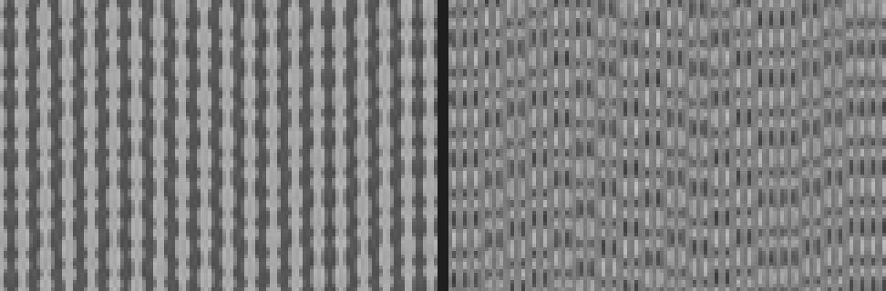
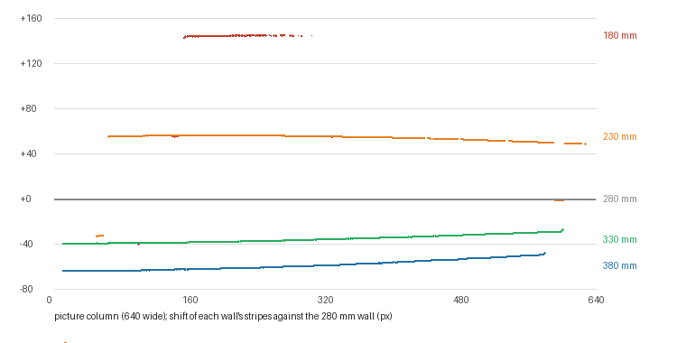
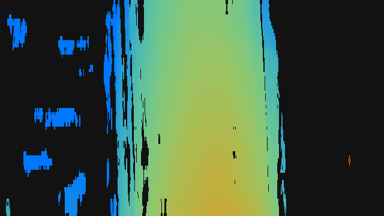

# The real pattern is stripes: the first real wall test, 18 October 2026

The second round of tests on the owner's CR-Scan Lizard. The first real wall test failed, and the reason
turned out to be the projector's pattern. The scanner's serial is removed from everything here.

## What happened

| Seen | By |
|---|---|
| After the wall test (180, 230, 280, 330, 380 mm) the Depth view was mostly red and green noise | Owner |
| Both lights work; the brightness setting is "perfect" | Owner |
| Camera A was "iffy about seeing dots"; dots may be a false assumption | Owner |
| "The IR laser projects vertical lines with staggered dots" (two photos of the pattern) | Owner |
| The calibration only saved after pressing FIT AND SAVE | Owner |
| Request: all the calibration material in one folder, for easy zipping | Owner |

The owner then sent the calibration folder (0.4's `reference.npz` with all five wall patterns) and one
snapshot from camera A (a mug held in front of the scanner, 1280x720, 1 ms, gain 65).

## What the data shows

**0.4's fit had failed.** Its calibration.json gave K 12,080 px·mm, c 60 mm (the edge of its search) and
an RMS of 23.6 px. Phase correlation of whole wall pictures found peaks of about 0.03: no real match.
That bad fit is the red and green noise.

**The pattern** (left: the 280 mm wall, 120 x 80 px of the 640-wide working picture, enlarged 4x; right:
its stripe code):

- Vertical stripes 6.34 px apart at 640 wide (about 12.7 px at 1280).
- Along each stripe, beads whose width and sideways position wobble irregularly, differently on every
  stripe. That is the "staggered dots".
- On stripes that repeat every 6.3 px, square windows match almost anywhere: the best and second-best
  alignments were within 0.03 of each other, and right only 2 to 6 times in 10.
- Taking away each pixel's running mean straight up and down (17 rows) removes the plain stripe and
  leaves the wobble, the **stripe code** (right). Matched in tall windows (49 x 21 at 640 x 360) the best
  alignment beats every other by about 0.25: clear.

**How far the stripes move between walls**, measured at every point (every 8th row, every column),
walls matched to their neighbours and chained to the 280 mm reference:

- Smooth everywhere the walls overlap. Neighbouring walls: 89, 56, 39 and 24 px at the left edge.
- The shift **changes across the picture**: 56 px at the left to 51 at the right between 230 and 280 mm.
  So one K for the whole picture (0.4's model) cannot fit; K varies by about 25% (39,000 to 52,000
  px·mm). The calibration now keeps a K map.
- The 180 mm wall moves about 145 px against the reference: the left of its picture has no partner in
  the reference wall, so it matches only from about column 160 (34% of the picture).
- Rough geometry: with the focal length still guessed (about 830 px), K of about 48,000 px·mm means a
  baseline of about 58 mm between the projector and camera A.

**Refitted with 0.5's method** (the full report: [reports/2026-10-18_wall_calibration_refit.txt](reports/2026-10-18_wall_calibration_refit.txt)):

| Wall (mm) | Matched | Shift (px) | Error (mm) | Spread (mm) | Right minus left (mm) |
|---|---|---|---|---|---|
| 180 | 34% | 143.2 | +0.7 | 0.7 | -1.2 |
| 230 | 70% | 55.8 | -1.6 | 0.8 | -2.5 |
| 280 | reference | | | | |
| 330 | 86% | -36.3 | +1.9 | 1.8 | -3.9 |
| 380 | 81% | -59.9 | -1.6 | 2.3 | -5.2 |

Every wall comes back within 2 mm of the tape measure. Every wall is deeper on the left, more so
further away: the scanner was turned about 1.7 degrees to the wall, which also widens the spread.
The optical centre came out 42 mm in front of the glass, which is not physical; with five walls,
c and K trade off against each other, and a tape-measure error of a millimetre or two moves c a lot.
Depth inside the measured range is what counts.

**Depth from the snapshot.** The mug, held about 30 cm away, comes out as a curved surface, about
294 mm in the middle of its face and 301 to 312 mm towards its sides. The hand holding it is closer than
the working range and has no depth. 44% of the view has depth; a full search took about 0.55 s on the
build machine, tracking about 0.14 s.

## What changed in 0.5.0 because of it

- Depth matches the stripe code in tall windows, along x, with a K map; a wall that disagrees with the
  others is left out of the fit.
- The simulator projects stripes with wobbling beads (and lights every picture), so the tests exercise
  the real kind of pattern.
- Diagnostics look for stripes, not dots (a tile is striped when the picture changes at least 1.6 times
  as much along x as along y; the mug snapshot scores 56% of the view).
- The wall test saves every wall the moment it is recorded (patterns and three of the camera's own
  full-size JPEGs), fits and saves from the third wall on, and warns before closing with an unfitted set.
- **One folder per scanner:** `calibration/<serial>/` holds everything (fit, wall patterns, shift maps,
  report, the camera's wall pictures). ZIP CALIBRATION packs it into one file with the serial hidden.
- An old 0.4 calibration is refitted from its saved walls ("Load saved walls"); no new walls needed.

## The first live test, 19 October

The owner recorded a new calibration (180, 230, 280 and 330 mm) and ran Diagnostics against a wall at
about 25 cm with 0.5.0. Seen: the Depth view mostly green with red vertical streaks; an object as a few
green specks; the flat wall check found depth in 0% of the view. The report's own numbers:

- Camera A: 10.1 pictures a second, stripe pattern in every picture, 100% of the view striped, room
  infrared 20 of 255 between the stripes.
- New calibration: K 54,000 to 75,000 px·mm, c 14.5 mm, walls fit within 2.3 mm, but only 50 to 70% of
  each wall matched its neighbour (the 18 October walls: 70 to 86%).
- Speed on the owner's i5-8350U: 3.1 s for a full depth search, 0.49 s tracking (about six times slower
  than the build machine).

The live picture saved in the report, run through **the 18 October calibration** (refitted with 0.5),
comes out as a flat wall at 240.7 mm over 84 to 95% of the view. So the matcher works on live pictures
and the 18 October calibration still fits the scanner. The red streaks are wrong-stripe matches; 0.5.1
drops them by checking each point against its neighbours. Why the new calibration does worse live is
not known yet: its walls were not in the report. Next: ZIP CALIBRATION of it.

## Still open

- Live depth on the real scanner (only one saved snapshot so far).
- A full-size (1280x720) fit: the wall JPEGs are now kept for it.
- The optical centre: a sixth wall, or the picture's measured width, would pin c and the focal length.
- Whether gain changes either light; what the 17:31 light-test run did differently.
